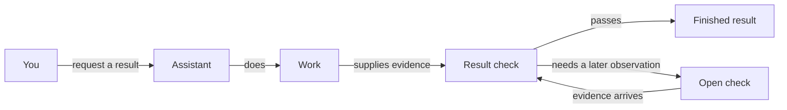

# How does a request get finished?

You give the assistant a result to achieve. It does the work and checks the result against what you asked for. Work that passes its required checks can finish without a later waiting period.

## The request

A message starts the work. The assistant identifies the result owed and the decisions that remain yours. It asks when the next action needs your approval.

## The work

The task's tracker item keeps the result and its completion check. The assistant works directly or gives a bounded job to another agent. Returned work supplies evidence for the required check.

## The result

A passing check records what establishes the result. If the work needs a future observation, the open check retains that obligation and its next action. An interruption changes who continues the task, not what is still owed.

## Your choices

You choose the result and the decisions you delegate. Your standing instructions name who can accept the work.

## Related pages

In a package with separate message, delegation and check pages, link each subject here. Those pages explain their own questions rather than repeat this full path.

---

## Not this

> Every task goes from request to worker, merge, Verifying, handover and completion.

This makes waiting and recovery mandatory stages. The direct path above shows ordinary completion and branches only when another observation is needed.

> The event reader invokes `task_launch`, writes `run_id`, then calls `check_result`.

The person asked what happens to their request. Function names and internal fields answer an implementation question instead.
