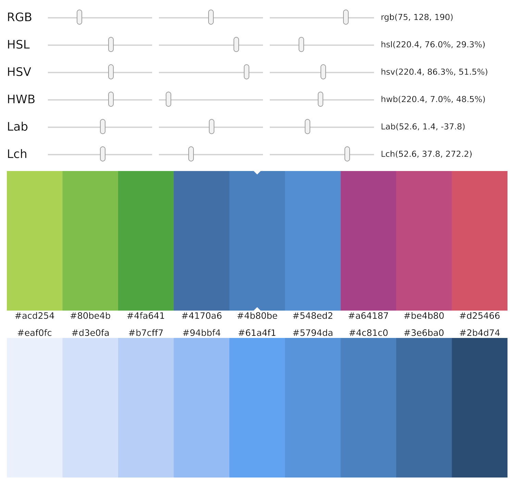

# Color palette

Choose a base color and view the derived palette.



Read the [example source](src/main.rs).

## Run

Run from the root of the [Iced 0.14.0 workspace](../README.md#install).

```sh
cargo run --package color_palette
```
