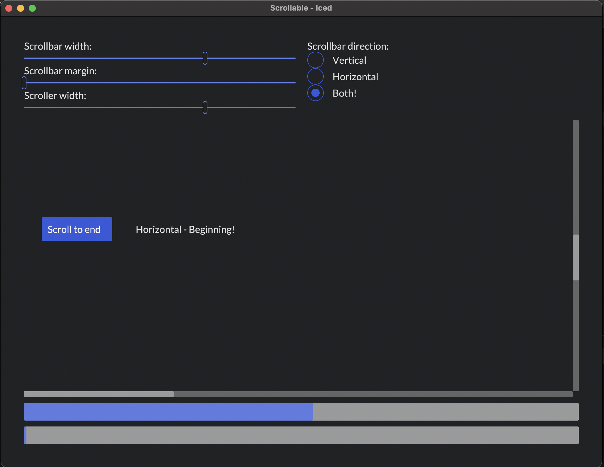

# Scrollable

Compare scroll directions, alignment, and scrollbar dimensions.

[](screenshot.png)

Read the [example source](src/main.rs).

## Run

Run from the root of the [Iced 0.14.0 workspace](../README.md#install).

```sh
cargo run --package scrollable
```
