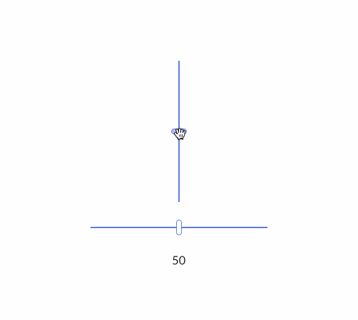

# Slider

Select a value from a range with a horizontal `Slider` or a `VerticalSlider`.



Read the [example source](src/main.rs).

## Run

Run from the root of the [Iced 0.14.0 workspace](../README.md#install).

```sh
cargo run --package slider
```
