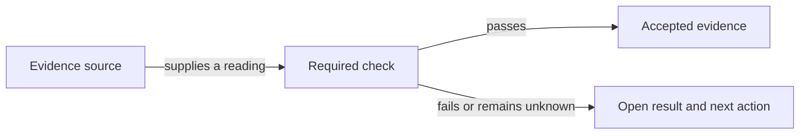

# What happens when a result needs another check?

A check compares the result owed with evidence from the place that can establish it. A passing check supplies completion evidence. Failed, missing or unreadable evidence leaves an unresolved result and a next action.

## The extra observation

Most work can be checked before it finishes. Some results need an installation, later use or a person's own screen or hands. The tracker records the required observation, where its evidence lives, when it becomes due and its deadline.

The merged item stays in Verifying while its admitted later checks remain open. When Jarvis sent a fix to another owner, the continuing session's own linked check item retains the separate observation where the problem was seen. [Delegation](HIW-delegation.md) explains that ownership.

## The evidence

Jarvis reads the named source and records what it establishes. A failed check needs a repair decision. Missing evidence needs a readable source or a dated decision about waiting. Another owner's completion mark cannot supply an observation it did not make.

## Planned alignment

The shared completion rules are still being aligned. The intended model gives every check one of the endings below. This table describes that target; it does not claim that all installed routes already implement it.

| Ending | Meaning |
|---|---|
| Met | The evidence establishes the required result. |
| Failed | The evidence shows a failure, with one linked repair item. |
| Inconclusive | The evidence cannot decide; a dated decision retains the next action. |
| Waived | An authorized person removes the requirement and records why. It is not a passing observation. |
| Replaced | A named item carries the replacement requirement. |

The current scheduled verification route still records an authorized dropped check as a tick with the person's reason. It also has its own missing-evidence waiting procedure. That difference remains unresolved package work; a tick in that route does not itself establish a successful observation.

## Your choices

The responsible decision owner can supply an observation, decide whether to keep waiting or change a requirement within their authority. The retained record distinguishes that decision from evidence that the original result passed.

## Related pages

[Tasks](HIW-tasks.md) owns the ordinary path to completion. [Messages](HIW-messages.md) explains answers and receipts. [Delegation](HIW-delegation.md) explains another owner's result.
