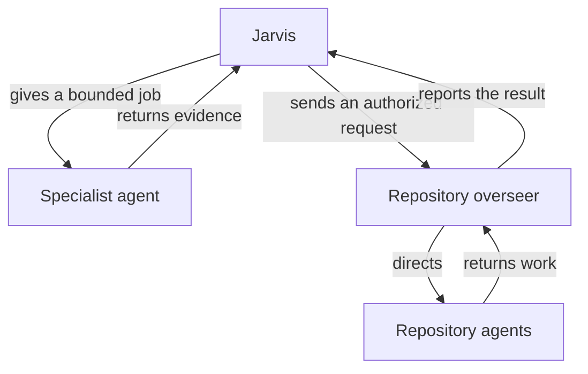

# How does Jarvis work with other agents?

Jarvis gives another agent a bounded job and checks the result it returns. A repository's overseer directs work inside that repository. Jarvis keeps responsibility for any separate result it still owes you.

## The job

Jarvis can ask a specialist for research, legal preparation, finance preparation, an audit or another defined result. The brief names the task, inputs and output. The specialist's result stays available for Jarvis to inspect after the worker finishes.

The declared specialist agents require the kendex Jarvis installation. An app that supplies only the Jarvis skill folder does not supply those agent files. The [installation instructions](../README.md#install) cover the bundle.

## Repository work

Jarvis reaches a repository through that repository's own communication channel. Its overseer applies the repository's workflow for workers, reviews, checks and delivery. Jarvis receives the overseer's report and decides what to tell you.

The [message page](HIW-messages.md) explains requests, questions and answers. Reaching a repository grants no additional authority to act there.

## Acceptance and recovery

The parent that requested a result records its acceptance or the work still needed. Jarvis reads existing results before repeating a job after an interruption. A failed worker remains a failed attempt, with any available output retained for inspection.

When Jarvis sent a fix to another owner, a linked check in the continuing session's own task project retains the result Jarvis still owes. That check needs evidence from where the problem was seen. The [checks page](HIW-checks.md) explains that distinction.

## Your choices

Your responsibility map names decision owners and delegated actions. It can also state which specialist or repository should handle a class of work. A send in your name follows the approval boundary described in [Tools](HIW-tools.md).

## Related pages

[Tasks](HIW-tasks.md) explains the complete request. [Messages](HIW-messages.md) explains delivery. [Sessions](HIW-sessions.md) explains unfinished agents during a handover.
