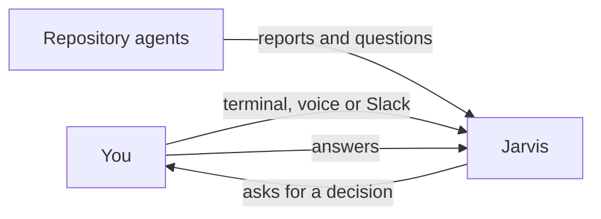

# How do requests and decisions reach Jarvis?

You can speak to Jarvis in a terminal or through a configured voice or Slack connection. Repository agents send reports and questions through their own channels. A delivery receipt establishes delivery; Jarvis still has to read the message and act on it.

## The channel

A direct conversation carries your request and Jarvis's reply. Slack needs its configured app and relay. Voice needs the consumer's voice connection. The Jarvis package does not turn every possible entry point on merely by being installed.

The configured event source collects messages from the Jarvis home and declared machines and brings settled bursts to the session. Each source retains its delivery progress for restart. An unavailable source is reported as unavailable; silence alone establishes no agent's state.

## Questions and answers

A question keeps its options and answer together. Jarvis presents an agent's question to you and records your answer against that question. Receiving an answer, resolving a question and achieving the requested result are separate events.

A receipt or a delivery reaction cannot prove that Jarvis read or applied the answer. Completion still needs the evidence described in [Tasks](HIW-tasks.md). The current task procedure reads the item's latest decisions and relevant exchanges, then records the authorized decision and next action. Delivery alone does not establish that those steps happened.

## A second machine

One machine acts as the main Jarvis. A satellite handles local screen, files, apps and sign-in. It asks before forwarding a request that belongs on the main and tells you whether delivery succeeded or remains queued. The request and answer appear in the owner's Slack channel.

Forwarding consent covers forwarding. It does not establish the caller's identity or approve a reserved action on the main. The main applies the action's own decision boundary.

## Your choices

You choose the channels, declared machines, main Jarvis and report schedule. A connection or reach setting changes where messages can travel; your responsibility map still controls the actions they request.

## Related pages

[Delegation](HIW-delegation.md) explains the agents on those channels. [Sessions](HIW-sessions.md) explains recovery. [Tools](HIW-tools.md) explains action approval.
