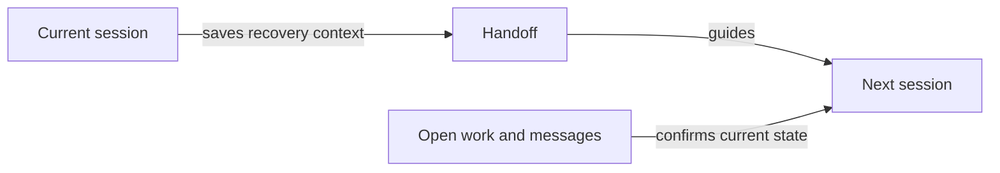

# How does work continue after a restart or handover?

Jarvis keeps unfinished work in the tracker and a compact handoff for session recovery. A new session checks those records against current sources before resuming work.

## The interruption

A restart, lost session or need for fresh conversation space can interrupt work. A handover changes the assistant in control; it does not complete the work.

## The handoff

The handoff identifies open work, unfinished agents, temporary instructions and the next unresolved actions. It links to the records that own the facts. Durable knowledge stays in [memory](HIW-memory.md), and task evidence stays with the task.

Before a normal handover, Jarvis collects the attached agents it launched. An emergency handoff records known unfinished agents and any unknown result locations or state. The next session checks available output before repeating work.

## The next session

Jarvis saves the handoff and starts the successor. The previous assistant stays in control until the successor confirms its identity and receives the start instructions. The successor reads the recovery context, checks open tracker work and messages, and loads further guidance for the action it selects.

Old or incomplete notes widen the source checks. Unread evidence remains an unresolved next action.

If a successor fails its readiness check before the previous assistant ends, the previous assistant stays in control and Jarvis can try another eligible account. If the transfer stalls or fails after the previous assistant ends, that assistant remains stopped. The saved handoff retains the recovery context, and the transfer status guides the next step.

## Current coverage

The package currently manages terminal sessions and local session records. The shared runtime replacement is unfinished. This page describes the current package's handover procedure, not completed acceptance of that replacement across all supported assistants.

## Your choices

You choose the supported assistant and account, any model selection, and the trigger for a handover. Your Jarvis home can set when recovery notes count as stale and which temporary instructions remain in force.

## Related pages

[Home](HIW-home.md) explains what travels between machines. [Memory](HIW-memory.md) explains lasting knowledge. [Tasks](HIW-tasks.md) explains how the work itself finishes.
