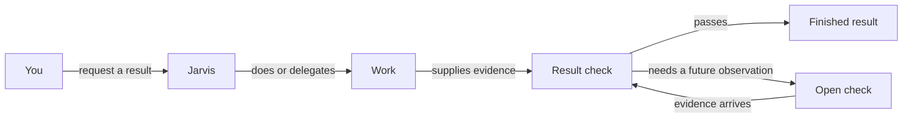

# How does a request get finished?

You give Jarvis a result to achieve and the authority to work toward it. Jarvis does the work, checks the result and tells you what the evidence supports. A task that passes its required checks can finish directly.

## The request

A request can arrive through the [message routes](HIW-messages.md). Jarvis reads the guidance needed for that task and checks which actions you have allowed. A decision reserved to you waits for your answer.

## The work

In a continuing session, work has a tracker item with the result still owed and the check that will establish it. Jarvis connects incoming events to that work and updates the item after acting. It can work directly or ask [another agent](HIW-delegation.md) to provide a result.

The tracker keeps unfinished work. The conversation carries requests and replies. Recovery notes keep only what another session needs to continue. These records have different jobs.

## The result

Jarvis compares the completed work with its required result. A worker's return or a repository merge supplies evidence for that comparison. Neither alone proves that a problem is fixed where you encountered it.

When the available evidence passes the required checks, Jarvis records it and reports completion. If the task requires a future observation, the [open check](HIW-checks.md) retains what is still owed. A [session handover](HIW-sessions.md) is a recovery route when needed; it is not a stage every task passes through.

## Current coverage

The current package gives the continuing session one procedure for matching requests to work, applying current decisions and reusing existing attempts. It runs for incoming requests, replies, worker results, blocker changes and recovery checkpoints. This installed guidance does not establish that every consumer has adopted or executed it correctly. The shared runtime replacement remains unfinished.

## Your choices

You choose the work, the decision boundaries and the tracker project for the continuing session's own tasks. Your standing instructions can define who accepts a result and which actions need your decision.

## Related pages

[Messages](HIW-messages.md) explains receipt and answers. [Delegation](HIW-delegation.md) explains result ownership. [Checks](HIW-checks.md) explains unresolved evidence.
