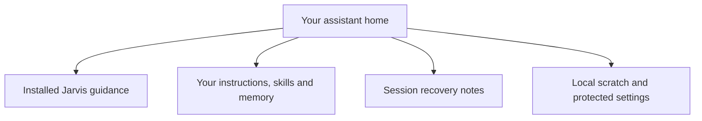

# What belongs in my Jarvis home?

Your Jarvis home keeps your instructions, own skills, memory and recovery notes beside the installed package. The package supplies shared guidance. Your personal records and local secrets remain under your control.

## Setting up the home

A home can be a plain folder used with a coding assistant or a home opened by an assistant app. A private Git repository lets committed instructions, skills, memory and recovery notes travel with its commits. Scratch and secrets stay local.

The [setup instructions](../README.md#customise) explain personal skills and settings. The [home layout reference](home-layout.md) gives the file locations and initial assistant setup.

## Shared and personal content

The installed package contains guidance that updates with Jarvis. Your standing instructions define your decision owners and permitted work. Your own skills hold task procedures, while [memory](HIW-memory.md) holds checked knowledge.

The tracker keeps work. The [handoff](HIW-sessions.md) keeps recovery context. Private official records and password-manager entries retain their own homes. A cloned folder does not copy local credentials or prove that connections are configured on its new machine.

## Updates

When kendex records the Jarvis installation, kendex controls package updates. An assistant app supplies updates in a home it manages without that kendex installation. The [update instructions](../README.md#update) explain the applicable route.

Package updates preserve your standing instructions, own skills, memory and handoffs. An edited kendex-managed package file stays in place as a reported conflict. Keeping personal changes in their own files lets the package receive updates without turning those files into package edits.

## Your choices

You choose the home, personal rules, own skills and supported connections. Machine-specific settings belong to that machine. If you use [satellites](HIW-messages.md#a-second-machine), the main remains responsible for shared home work.

## Related pages

[Memory](HIW-memory.md) explains durable notes. [Sessions](HIW-sessions.md) explains recovery. [Tools](HIW-tools.md) explains secrets and originals.
