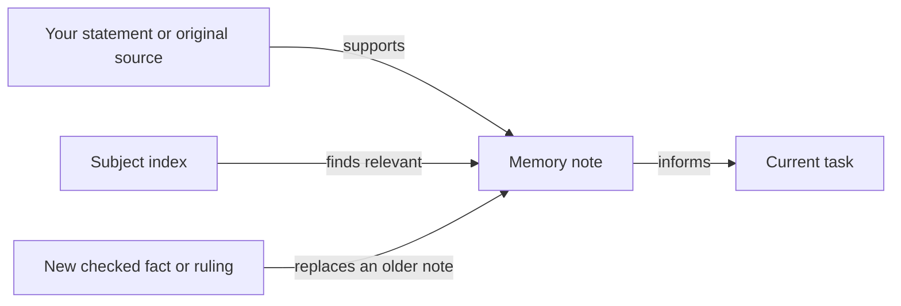

# What does Jarvis remember?

Jarvis keeps checked facts, your preferences and durable rulings in memory notes with their sources and dates. An index tells a session when to read each subject. Unfinished work stays in the tracker.

## The note

A lasting preference, checked fact, authorized ruling or useful correction can become a note. Each note identifies its source, the date it was checked or given, and the earlier note it replaces, if any. Information from an untrusted source remains pending until you confirm it.

## Finding the right subject

A session starts with the memory index. It reads a note when the task meets that subject's reading condition. This keeps the relevant context available without loading every personal fact into every task.

## Corrections and ownership

When a completed change makes a current note false, the note is updated or replaced. Its replacement names the superseded note, so the old statement stops reading as current. Dated observations and original sources can remain as history.

Memory records knowledge. It does not grant permission or override your instructions. Reusable ways to perform work belong in skills. Recovery context belongs in the [session handoff](HIW-sessions.md).

## Private originals

Official originals stay unchanged in your private record store. Memory keeps only useful metadata, such as the record type, checked date and storage location. Passwords and protected account details stay in their own protected stores, as [Tools](HIW-tools.md) explains.

## Your choices

Your home supplies the notes and the subjects you want available. You can change a preference or ruling and identify the earlier one it replaces. Your retention policy determines how long original evidence remains needed.

## Related pages

[Home](HIW-home.md) explains package files and personal files. [Sessions](HIW-sessions.md) explains temporary recovery context. [Tools](HIW-tools.md) explains credentials and records.
